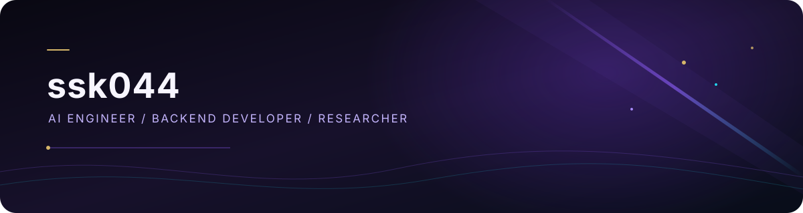

  

<h1 align="center">ssk044</h1>

<strong>AI Engineer&nbsp; | &nbsp;Backend Developer&nbsp; | &nbsp;Researcher</strong>

AI engineering · backend systems · research

<a href="https://github.com/ssk044">GitHub profile</a>

## Selected work

- **EDITH**
- **LLM Compiler Optimizer**
- **Internship Intelligence**
- **MISA**
- **Multi-Agent Civilization**

## Research

Research is part of my work. Publication details and research topics will be added here when ready.

## Connect

- [GitHub](https://github.com/ssk044)

Static artwork · Stored with this profile

