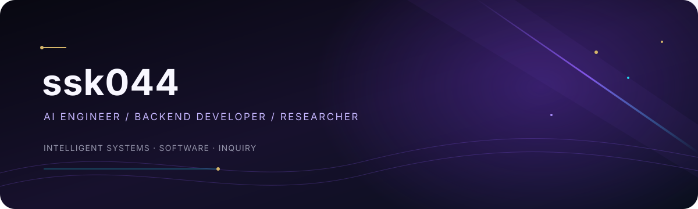
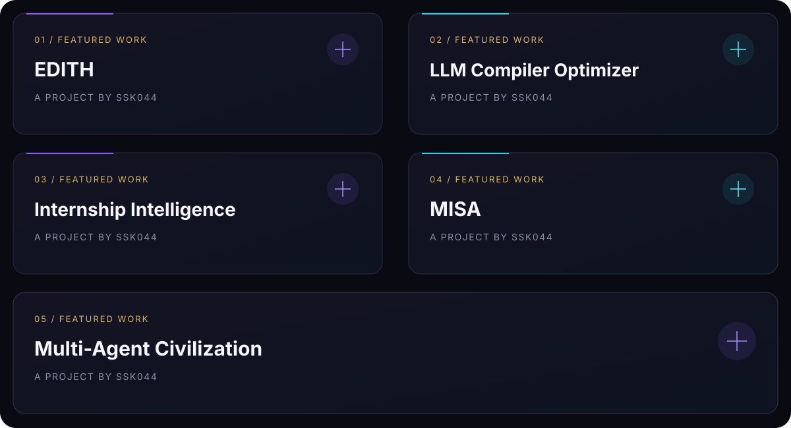
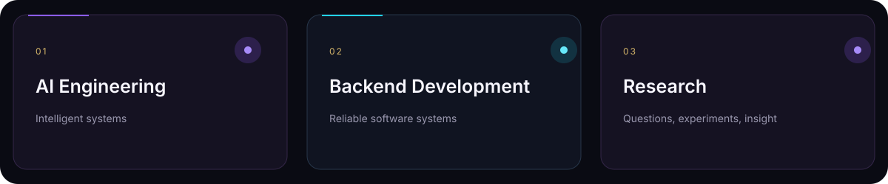

# ssk044

**AI Engineer | Backend Developer | Researcher**

AI engineering · backend development · research

[GitHub profile](https://github.com/ssk044)

---

## Selected work

- **EDITH**
- **LLM Compiler Optimizer**
- **Internship Intelligence**
- **MISA**
- **Multi-Agent Civilization**

## Technical skills

- AI Engineering
- Backend Development
- Research

## Research

Research is part of my work. Verified publications and details will be added here when available.

## Connect

[GitHub — ssk044](https://github.com/ssk044)

